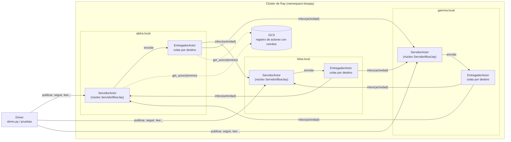
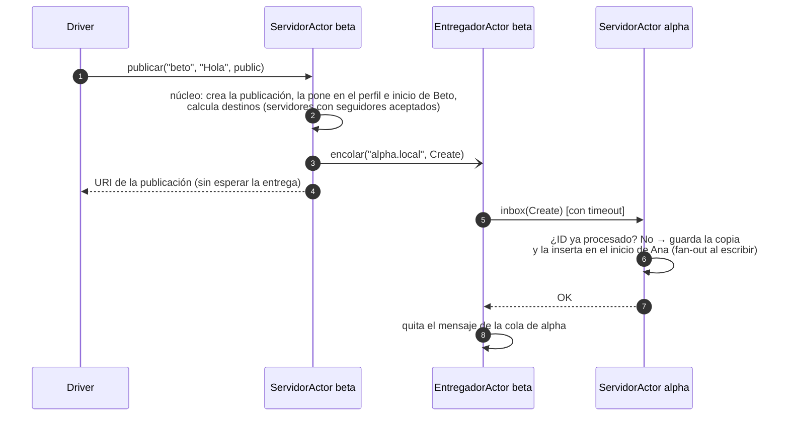
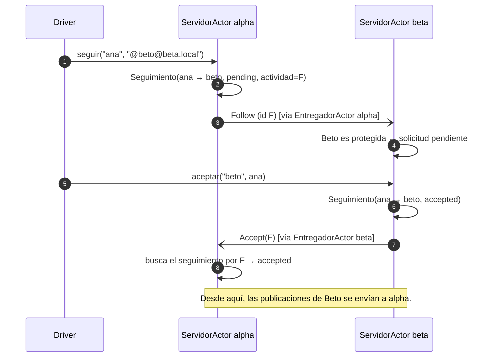
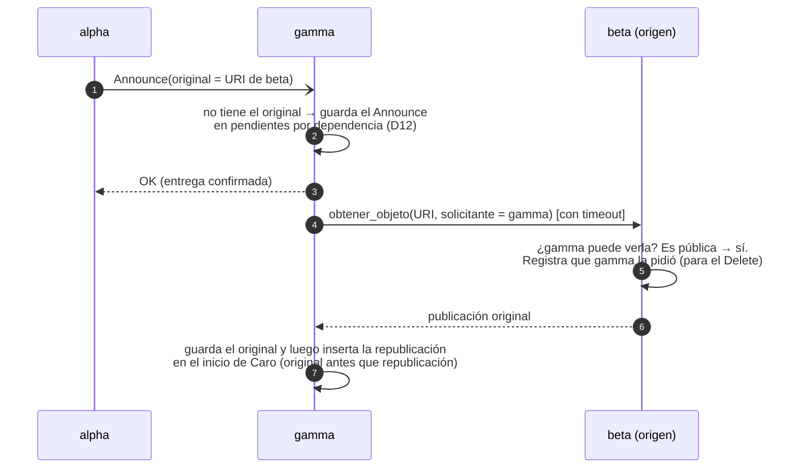
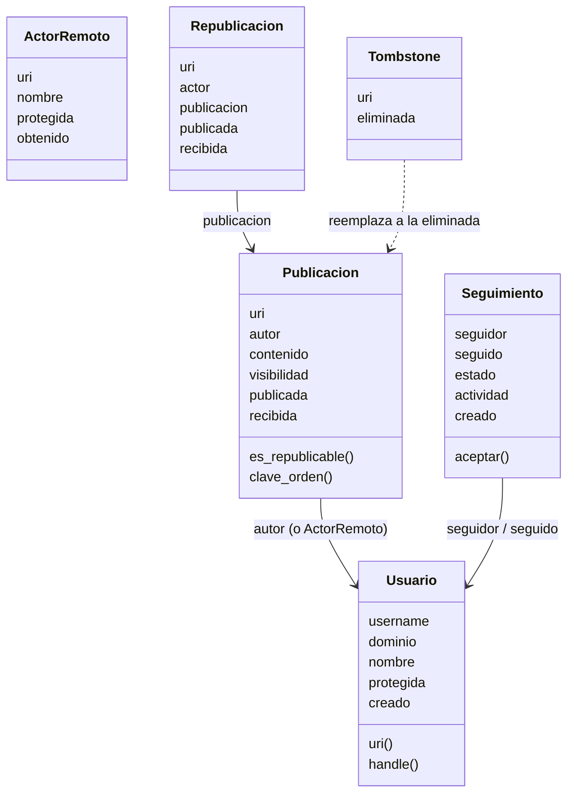

# Arquitectura

Arquitectura de Blue Jay en la **Entrega 1 (versión con Ray)**. Las decisiones citadas (D1–D17) están en `decisiones.md`; la semántica de visibilidad, en `visibilidad.md`.

---

## 1. Visión general

Blue Jay es una red social **federada**: varios servidores, cada uno administrado por separado, cuyos usuarios se siguen y se leen entre servidores.

Según la clasificación de Conf. 1:
- Es un sistema **descentralizado**: el **control** está repartido. Ningún servidor manda sobre los demás y cada uno es dueño de sus usuarios y publicaciones.
- Es una **topología híbrida**: entre usuarios y su servidor es cliente-servidor; entre servidores es de igual a igual (todos los servidores tienen el mismo rol).
- El eje de escalabilidad principal es el **administrativo**: no hay autoridad única ni configuración global.

Según los estilos de Conf. 2, la arquitectura es **híbrida**:
- **Dentro de un servidor**, las operaciones de sus usuarios son llamadas directas a su actor (cliente/servidor).
- **Entre servidores**, la comunicación es **orientada a eventos**: el servidor de origen emite actividades y no espera a que los destinos las procesen (D4).

En la Entrega 1, Ray es el **middleware** (Conf. 1 y 2): resuelve el transporte, el descubrimiento por nombre y la ubicación de los procesos.

---

## 2. Componentes

| Componente | Qué es | Responsabilidad |
|---|---|---|
| **Driver** (`demo.py`, pruebas) | Proceso principal de Ray (Conf. 2) | Crea los servidores y actúa en nombre de los usuarios: publicar, seguir, leer. Es el sustituto de la interfaz web en esta entrega. |
| **`ServidorActor`** | Actor asíncrono con nombre, uno por dominio (D1, D17) | Envuelve el núcleo. Recibe las operaciones de sus usuarios y las actividades de otros servidores (`inbox`). Responde a `obtener_objeto` y `obtener_actor`. |
| **`ServidorBlueJay`** (núcleo) | Clase de Python puro, dentro de cada `ServidorActor` (D2) | Todo el estado y la lógica: usuarios, publicaciones, seguimientos, visibilidad, líneas de tiempo. Devuelve las entregas a realizar. |
| **`EntregadorActor`** | Actor, uno por dominio | Colas FIFO acotadas por destino, reintentos con *backoff* y *dead letter* (D6). Es el *buffer* que desacopla al servidor de los destinos (D4). |
| **GCS** | Servicio de control de Ray (Conf. 2) | Registro de actores con nombre: resuelve un dominio a su actor (D16). |

---

## 3. Las seis dimensiones aplicadas a Blue Jay

Las seis dimensiones de responsabilidad de Conf. 2 permiten evaluar la arquitectura sin bajar todavía a los mecanismos:

| Dimensión | En Blue Jay (Entrega 1) |
|---|---|
| **1. Estado y datos** | Estado encapsulado y privado por servidor (*shared-nothing*, Conf. 3). Cada servidor es **la fuente de verdad** de sus usuarios y publicaciones. Las copias de contenido remoto son **cachés**, no fuentes de verdad. |
| **2. Acoplamiento** | **Asíncrono** entre servidores: publicar no espera a los destinos (D4). Síncrono solo en dos casos: las operaciones del driver sobre su propio servidor y `obtener_objeto` (D12), que siempre tiene *timeout*. |
| **3. Topología y escala** | Particionamiento **por dominio**: cada usuario vive en un solo servidor. La escala viene de agregar servidores independientes, no de replicar uno. |
| **4. Descubrimiento y scheduling** | Descubrimiento por **registro** (GCS de Ray, D16). Ray decide en qué proceso corre cada actor. |
| **5. Fallos parciales** | Se asume que los servidores fallan de forma independiente: modo *offline* (D14), reintentos con *backoff*, *dead letter*, *timeouts* en toda llamada remota (D6, D17). Un destino caído degrada solo sus entregas, sin derrumbar a los demás. |
| **6. Semántica y observabilidad** | Entrega *at-least-once* con efecto *exactly-once* (D7); orden FIFO por origen; consistencia eventual y causal para republicaciones (`visibilidad.md`, sección 7). Observabilidad con `estado()`, `pendientes()` y `dead_letters()`. |

---

## 4. Flujos principales

### 4.1 Publicar y llegar a un seguidor remoto

Beto (`beta`) publica y Ana (`alpha`), que lo sigue, lo ve en su inicio.

Si `alpha` está *offline* en el paso 5, la llamada falla y el mensaje se queda primero en la cola de `alpha`. El entregador lo reintenta con *backoff* hasta que `alpha` vuelva o se agoten los intentos (D6, D14).

### 4.2 Seguir a una cuenta protegida remota

Si Beto no fuera protegida, `beta` respondería con `Accept` sin intervención (pasos 4 y 5 automáticos).

### 4.3 Republicar contenido de un tercer servidor

Ana (`alpha`) republica una publicación de Beto (`beta`). Caro (`gamma`) sigue a Ana, pero `gamma` no tiene la publicación original.

Si `beta` no responde en el paso 4, `gamma` reintenta la obtención con *backoff*. La republicación sigue sin mostrarse mientras tanto.

### 4.4 Eliminar

`beta` envía `Delete` a todos los servidores que recibieron la publicación (D5) o la pidieron (D12). Cada receptor borra su copia, la quita de las líneas de tiempo, elimina las republicaciones locales y guarda un *tombstone* (D13).

---

## 5. Contrato entre servidores: las actividades

Los servidores solo se comunican mediante **actividades**: diccionarios con la forma de ActivityPub (subconjunto). Son el contrato de la federación (D2).

| Tipo | Significado | Lo envía |
|---|---|---|
| `Create` | Nueva publicación | Autor → servidores con seguidores |
| `Delete` | Publicación eliminada | Autor → servidores que la recibieron o pidieron |
| `Announce` | Republicación | Quien republica → servidores con sus seguidores |
| `Undo(Announce)` | Deshacer republicación | Igual que `Announce` |
| `Follow` | Solicitud de seguimiento | Seguidor → servidor del seguido |
| `Accept` / `Reject` | Respuesta a un `Follow` | Seguido → servidor del seguidor |
| `Undo(Follow)` | Dejar de seguir | Seguidor → servidor del seguido |

Reglas del contrato (Conf. 4):

- **Identidad:** toda actividad lleva un `id` único. Es la base de la deduplicación (D7).
- **Compatibilidad hacia adelante:** el receptor **ignora los campos que no conoce**. Una versión más nueva de un servidor puede agregar campos sin romper a las anteriores.
- **Serialización:** dentro de Ray las actividades viajan con la serialización del middleware (`pickle`). Se mantienen como diccionarios de tipos simples para que la versión HTTP las envíe como JSON sin cambios.

---

## 6. Semántica de la comunicación

| Interacción | Tipo (Conf. 4) | Semántica |
|---|---|---|
| Driver → su `ServidorActor` | Síncrona (llamada a un objeto remoto con estado) | El driver espera la respuesta. |
| `ServidorActor` → su `EntregadorActor` | Asíncrona, sin esperar (*fire-and-forget*) | `encolar` no bloquea la operación del usuario. |
| `EntregadorActor` → `inbox` remoto | Asíncrona + persistente (en la cola) | *At-least-once* con reintentos; FIFO por destino; *dead letter* tras N intentos (D6). |
| `inbox` (receptor) | — | Deduplicación por ID e idempotencia: efecto *exactly-once* (D7). |
| `obtener_objeto` | Síncrona con *timeout* | Petición–respuesta puntual (*pull*, Conf. 5) para resolver dependencias (D12). |

**Llamar a un método de un actor de Ray es un RPC hacia un objeto remoto** (Conf. 4). No se puede tratar como una llamada local:
- Un *timeout* no dice si el destino procesó la actividad.
- La referencia puede quedar inválida si el actor se reinicia.

Por eso toda llamada remota tiene *timeout* y reintento (D6, D16).

---

## 7. Concurrencia dentro de un servidor

- Cada `ServidorActor` procesa sus mensajes **uno por vez entre puntos de espera**: no hay *data races* en su estado (D1).
- Los métodos son asíncronos. Mientras uno espera una respuesta remota (`await`), el actor puede atender otro. Así se evita el *deadlock* por espera circular entre servidores (Conf. 3).
- **Regla de diseño (D17):** ninguna decisión "leer → verificar → actualizar" se parte con un `await` en el medio. Si se necesita una respuesta remota, al volver se **vuelve a verificar** el estado antes de modificarlo, para evitar carreras lógicas (Conf. 3).
- **Ninguna espera es infinita:** toda llamada remota usa `asyncio.wait_for(..., timeout)`.

---

## 8. Modelo de datos

Los modelos están en `bluejay/dominio/modelos.py`. Todas las fechas están en UTC.

| Modelo | Qué representa | Fuente de verdad |
|---|---|---|
| `Usuario` | Usuario alojado en este servidor | Este servidor |
| `ActorRemoto` | Copia en caché de un usuario de otro servidor (con fecha de obtención) | Su servidor de origen |
| `Publicacion` | Publicación propia, o copia de una remota. `publicada` es la hora del origen (orden, D9); `recibida`, la hora de llegada (medición del retardo). | Su servidor de origen |
| `Republicacion` | Republicación (`Announce`); su URI es el ID de la actividad | El servidor de quien republica |
| `Seguimiento` | Relación dirigida A → B, `pending` o `accepted`, con el ID del `Follow` | Ambos servidores guardan su lado |
| `Tombstone` | Marca de una publicación eliminada (D13) | — |

**Estado de cada servidor** (en `ServidorBlueJay`, todavía por implementar):

| Estructura | Uso |
|---|---|
| Usuarios locales y actores remotos en caché | Identidades |
| Publicaciones, republicaciones y *tombstones* | Contenido propio y copias |
| Seguimientos | Grafo dirigido; de él salen los destinos de cada entrega (D5) |
| Línea de inicio por usuario local | *Fan-out* al escribir (D8) |
| IDs de actividades procesadas | Deduplicación (D7) |
| Republicaciones pendientes por dependencia | Espera causal (D12) |
| Servidores que recibieron o pidieron cada publicación propia | Destinos del `Delete` (D13) |

**Estado de cada entregador:** una cola FIFO acotada por dominio destino (actividad, intentos, próximo intento) y la lista de *dead letters* con su motivo (D6).

---

## 9. Límites conocidos de esta arquitectura

| Límite | Consecuencia | Cuándo se resuelve |
|---|---|---|
| Todos los actores en una máquina: **un solo dominio de fallo** (Conf. 3) | La independencia de los servidores es lógica, no física | Tarea opcional F.3 (un nodo de Ray por servidor) o versión HTTP |
| Estado en memoria (D3) | Un *crash* pierde el estado del servidor | Opcional F.2 (SQLite); Postgres en la entrega final |
| Sin autenticación entre servidores (D15) | Un servidor podría hacerse pasar por otro dentro del clúster | HTTP Signatures en la entrega final |
| GCS como registro central (D16) | Punto crítico para el descubrimiento | DNS + WebFinger en la versión HTTP |
| Sin reconciliación por *pull* | Lo que pasa a *dead letter* no se recupera | Trabajo futuro (*push-pull*, Conf. 5) |
